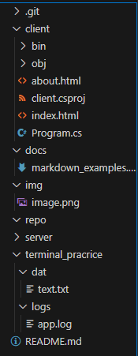

## Лабораторная 4
___ 
**Фио: Донскова Ульяна Сергеевна Группа: ИСП-242 Дата: 25.10.2026**

В этой работе я делала самостоятельно задания

+---client
|   +---bin
|   |   \---Debug
|   |       \---net10.0
|   \---obj
|       \---Debug
|           \---net10.0
|               +---ref
|               \---refint
+---docs
+---img
+---repo
+---server
\---terminal_pracrice
    +---dat
    \---logs

# заголовок
1. список
2. список
3. список

~~~bash
git add .
~~~

$a^2 + b^2 = c^2$

$$
\sum_{i=1}^n i = \frac{n(n+1)}{2}
$$

[github](https://github.com/donskova07/Lab4_ISRPO_donskova)

~~~bash

10.
Подводя итоги, можно сказать, то что работа, проделанная сегодня, надеюсь, будет хорошо оцененна.